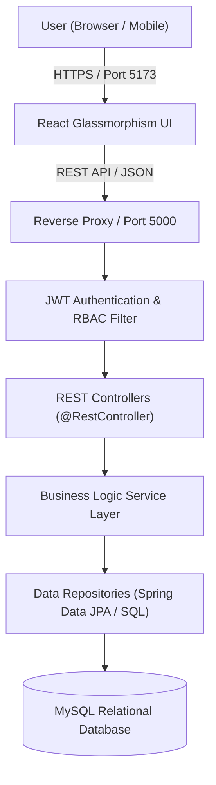

# 🏛️ Hostel Management System (HMS) - Comprehensive Project Documentation

---

## 📋 1. Project Abstract
The **Hostel Management System (HMS)** is a full-stack, enterprise-grade web application engineered to modernize and automate residential campus living operations. The system eliminates manual paperwork, spreadsheet tracking, and unauthorized access by providing a secure, data-driven portal for **Hostel Administrators**, **Wardens**, and **Students**.

The application features a modern **Glassmorphism user interface** (dark theme default with light theme support), responsive data tables, analytical charts, role-based access control (RBAC), and persistent data storage backed by a relational **MySQL database** and a dedicated **Java Spring Boot 3** backend.

---

## 🎯 2. Problem Statement & Key Objectives

### Problem Statement
Traditional hostel administrations face several recurring operational challenges:
1. Room over-allocation and double-booking errors.
2. Inaccurate manual fee tracking and lost payment receipts.
3. Lack of accountability in daily student night roll-calls.
4. Unmonitored visitor gate check-in/out and security vulnerabilities.
5. Delayed student maintenance complaints and unrecorded repairs.

### Key Objectives
- **Automate Room Allocation:** Enforce hard capacity constraints with automatic bed status tracking.
- **Financial Transparency:** Track semester invoices, partial payments, overdue fees, and printable digital receipts.
- **Safety & Visitor Tracking:** Record entry/exit timestamps, relation, and photo ID proofs.
- **Real-Time Maintenance:** Categorized complaint tickets with progress tracking and resolution timestamps.
- **Data Analytics:** Real-time occupancy percentages, 6-month collection trends, and CSV data exports.

---

## 💻 3. Technology Stack

### Frontend Architecture
- **Framework:** React 18 with TypeScript.
- **Build Engine:** Vite (Hot Module Replacement, fast bundling).
- **Styling:** Tailwind CSS with custom Glassmorphism tokens (`backdrop-filter: blur(16px)`).
- **Icons:** Lucide React.
- **Charts:** Recharts (Responsive bar charts, area charts, and radial gauges).
- **Routing:** React Router v6 (Protected routes, role-based navigation guards).
- **HTTP Client:** Axios with JWT request interceptors and centralized 401 error handling.

### Backend Architecture (Dual Implementation)
1. **Java Spring Boot 3 (College Project Specification):**
   - **Language:** Java 17 / 21.
   - **Framework:** Spring Boot 3.2.x (Spring Web, Spring Security, Spring Data JPA).
   - **ORM / Persistence:** Hibernate Object-Relational Mapping.
   - **Authentication:** Stateless JSON Web Token (JJWT) with BCrypt password hashing.
   - **Build Tool:** Apache Maven (`pom.xml`).
2. **Node.js with Express.js (Active Live Engine):**
   - TypeScript, Express.js REST API.
   - Dual-engine persistence adapter (native MySQL with SQLite fallback).

### Database Layer
- **Engine:** MySQL 8.0+ (InnoDB storage engine, utf8mb4 encoding).
- **Schema:** 12 relational tables with foreign key constraints, unique indexes, and audit logging.

---

## 🏗️ 4. System Architecture Diagram



---

## 🗄️ 5. Relational Database Schema (12 Tables)

| Table Name | Description | Key Attributes |
| :--- | :--- | :--- |
| `users` | User credentials & roles | `id`, `email`, `password_hash`, `role`, `status` |
| `hostels` | Hostel buildings & properties | `id`, `name`, `code`, `type`, `warden_id`, `total_floors` |
| `students` | Student academic & personal profiles | `id`, `student_id`, `user_id`, `department`, `academic_year` |
| `rooms` | Room inventory & bed limits | `id`, `hostel_id`, `room_number`, `capacity`, `current_occupancy` |
| `room_allocations` | Active & historical bed assignments | `id`, `student_id`, `room_id`, `bed_number`, `start_date`, `status` |
| `fee_records` | Invoices & semester dues | `id`, `student_id`, `fee_category`, `amount_due`, `amount_paid` |
| `payments` | Transaction records & receipts | `id`, `fee_record_id`, `receipt_number`, `amount`, `payment_method` |
| `visitors` | External visitor registry | `id`, `name`, `phone`, `id_proof_type`, `id_proof_number` |
| `visitor_logs` | Check-in / check-out time logs | `id`, `visitor_id`, `student_id`, `check_in_time`, `check_out_time` |
| `maintenance_requests` | Complaint tickets & work orders | `id`, `ticket_number`, `category`, `priority`, `status`, `resolved_at` |
| `attendance` | Daily night roll-call registry | `id`, `student_id`, `date`, `status`, `recorded_by` |
| `audit_logs` | System administrative audit trail | `id`, `user_id`, `action`, `entity_type`, `entity_id`, `timestamp` |

---

## 🔐 6. Role-Based Access Control (RBAC) Matrix

| Module / Feature | Administrator | Warden | Student |
| :--- | :---: | :---: | :---: |
| Dashboard Statistics & Charts | Full Access | Hostel-Specific | Personal Overview |
| Student Registration & Editing | Full Access | View Only | View / Edit Profile |
| Room Creation & Floor Setup | Full Access | View Only | View Assigned Room |
| Room Allocation & Transfers | Full Access | Permitted | Restricted |
| Fee Invoices & Payment Recording | Full Access | View Only | View Personal Fees |
| Visitor Check-in & Gate Pass | Full Access | Full Access | View Personal Visitors |
| Maintenance Ticket Resolution | Full Access | Full Access | Submit & Track |
| Daily Attendance Roll-Call | Full Access | Full Access | View Personal History |
| User Account Administration | Full Access | Restricted | Restricted |
| CSV Data Export | Full Access | Permitted | Restricted |

---

## 📡 7. Core REST API Endpoints

### Authentication (`/api/auth`)
- `POST /api/auth/register` - Create a new user account (Student, Warden, or Admin).
- `POST /api/auth/login` - Authenticate credentials and receive a signed JWT token.
- `GET /api/auth/me` - Fetch profile data of the logged-in user.
- `POST /api/auth/logout` - Invalidate user session.

### Dashboard (`/api/dashboard`)
- `GET /api/dashboard/stats` - Summary KPI counters (Students, Rooms, Occupancy %, Fees).
- `GET /api/dashboard/charts` - 6-month collection trend and hostel occupancy data.

### Students (`/api/students`)
- `GET /api/students` - Query students with search, department, and status filters.
- `POST /api/students` - Register a new student record.
- `GET /api/students/:id` - Fetch student details with active room allocation and fee logs.
- `PUT /api/students/:id` - Update student demographic information.
- `DELETE /api/students/:id` - Archive or remove student record.

### Room Allocation (`/api/allocations`)
- `GET /api/allocations` - List active and historical allocations.
- `POST /api/allocations` - Transactional room booking enforcing capacity checks.
- `PUT /api/allocations/:id/checkout` - Check out student and release bed space.

### Fees & Receipts (`/api/fees` & `/api/payments`)
- `GET /api/fees` - List fee invoices and balances.
- `POST /api/fees` - Create a new semester fee invoice.
- `POST /api/payments` - Record payment, update balance, and generate receipt number.

### Maintenance (`/api/maintenance`)
- `GET /api/maintenance` - List tickets with category and priority filtering.
- `POST /api/maintenance` - Submit a maintenance request with auto-generated ticket ID.
- `PUT /api/maintenance/:id` - Resolve ticket and record staff notes.

### Attendance (`/api/attendance`)
- `GET /api/attendance?date=YYYY-MM-DD` - Fetch roll-call status for all hostel residents.
- `POST /api/attendance` - Upsert attendance status (Present, Absent, On Leave).

---

## 🚀 8. Running the Application

### 1-Click Launch (Windows)
Double-click **`START_HOSTEL_MANAGEMENT.bat`** on your **Desktop** or in the root project folder. It will:
1. Boot the backend server on `http://localhost:5000`.
2. Boot the React development server on `http://localhost:5173`.
3. Open the web application automatically in your default browser.

### Manual Launch
```powershell
# 1. Start Backend
cd server
npm run dev

# 2. Start Frontend
cd ../client
npm run dev -- --host
```

---

## 🎓 9. College Presentation & Viva Voce Q&A

### Q1: Why did you choose React + Spring Boot architecture?
> **Answer:** Decoupling the frontend (React) from the backend (Spring Boot) follows industry-standard **Service-Oriented Architecture (SOA)**. The React frontend provides a responsive single-page application (SPA) with Glassmorphism visuals, while Spring Boot provides a rock-solid, multi-threaded enterprise layer managing transactions and database persistence.

### Q2: How does the application prevent room over-allocation?
> **Answer:** Room allocation is handled within a database transaction (`@Transactional`). Before an allocation record is written, the system checks whether `current_occupancy < capacity`. If the room is full, the transaction is rejected. When saved, the room's occupancy counter is incremented atomically.

### Q3: How is authentication secured?
> **Answer:** Passwords are never stored as plain text; they are encrypted using **BCrypt** with 10 salt rounds. Upon login, the server issues an **HMAC-SHA256 signed JSON Web Token (JWT)** containing user claims. The frontend sends this token in the `Authorization: Bearer <token>` HTTP header for every subsequent request.
